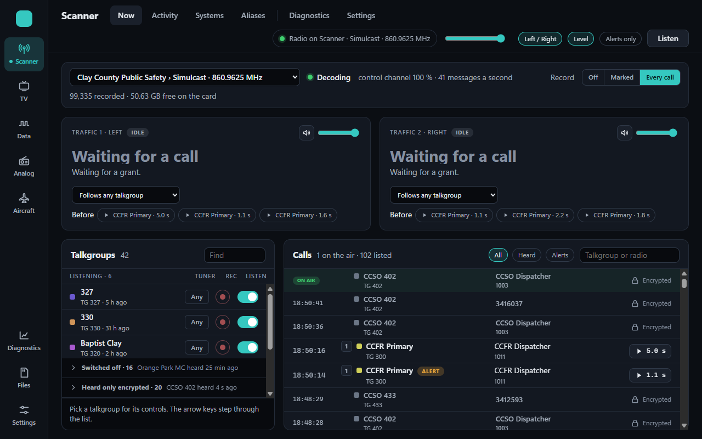
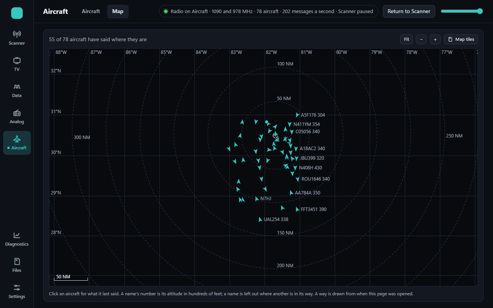
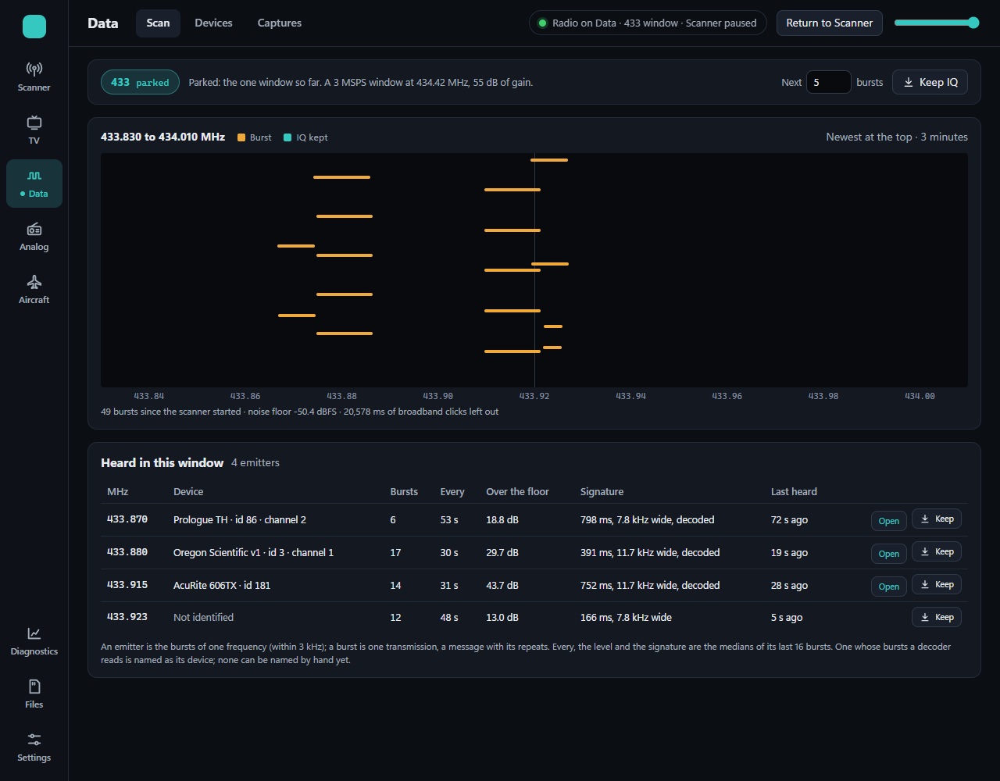
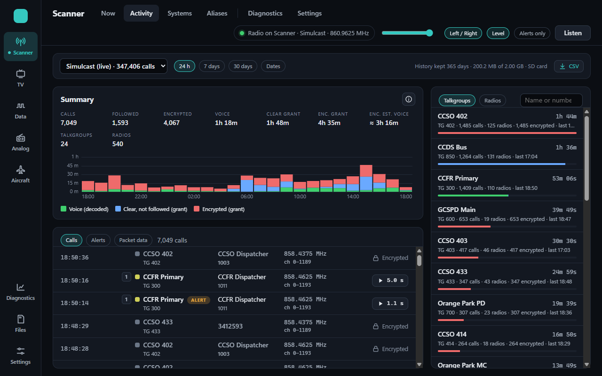
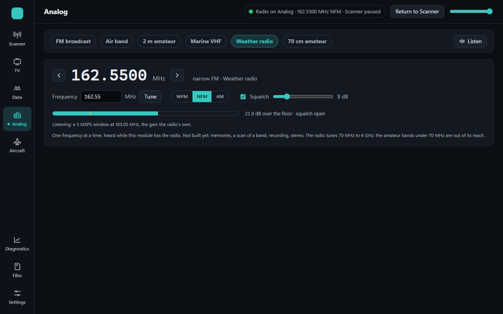
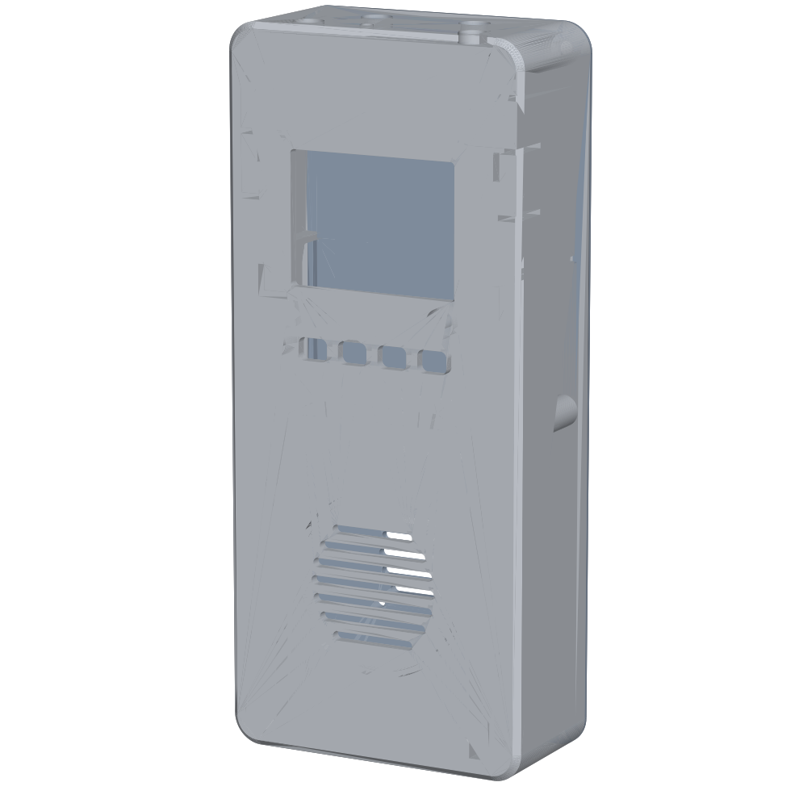
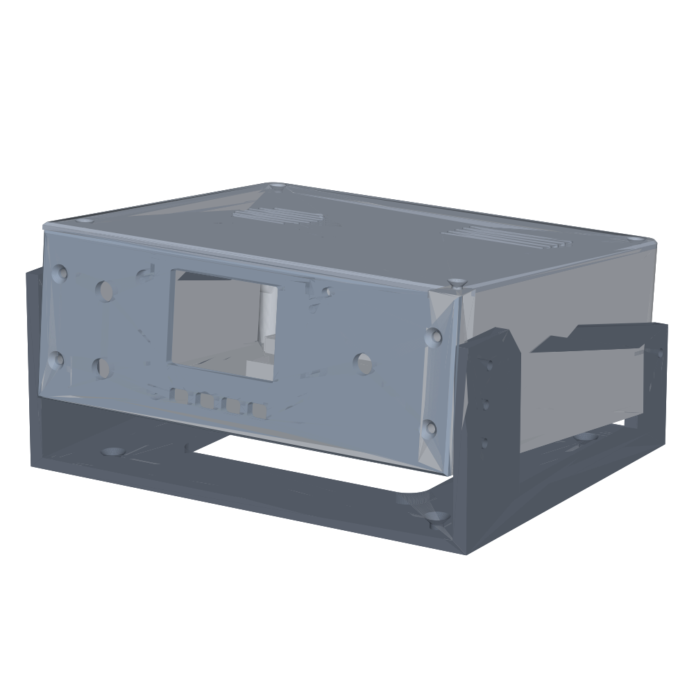
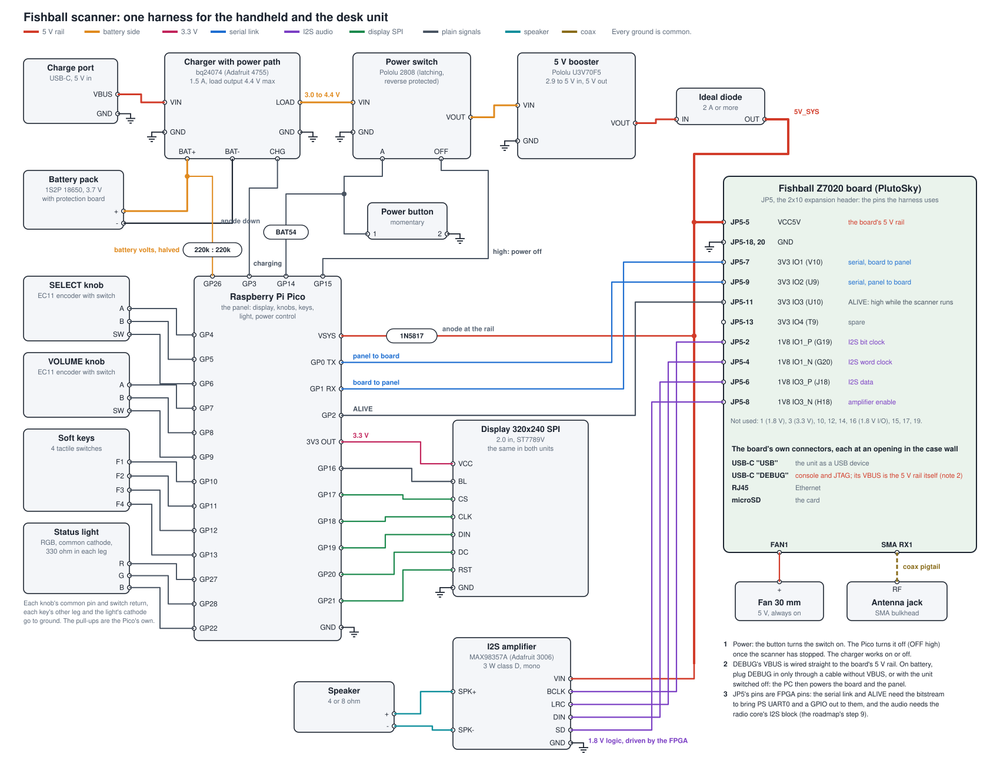

# Fishball scanner

A P25 and DMR trunking scanner on the Fishball Z7020 board (Zynq-7020 with an AD9361 or AD9363),
with four more receivers beside it: ATSC TV, 433 MHz devices, analog FM and AM, and aircraft
(ADS-B). It is a fork of [F5OEO/maia-sdr](https://github.com/F5OEO/maia-sdr), itself from
[maia-sdr/maia-sdr](https://github.com/maia-sdr/maia-sdr) by Daniel Estévez, and builds on Maia
SDR's gateware.

- **[User guide](doc/USER_GUIDE.md):** every page, with pictures.
- **[Hardware](hardware/README.md):** a wiring diagram and two printed cases, a handheld and a
  desk unit, for the board with a display, knobs, a speaker and a battery. On paper and in CAD
  so far: nothing has been wired or printed.
- **[Roadmap](doc/ROADMAP.md)** and **[change log](CHANGELOG_FORK.md).**

## What it does

The board has one receiver, so one module has the radio at a time:

- **Scanner:**
  - P25 Phase 1 trunking, on simulcast (LSM) and C4FM control channels;
  - DMR Tier III trunking;
  - calls followed on two traffic tuners, decoded (IMBE, AMBE+2) and played live in the
    browser;
  - talkgroup and radio aliases, with RadioReference and SDRTrunk playlist imports;
  - recordings, and a history of calls on the SD card.
- **TV (ATSC):**
  - a TV channel finder (pilot, carrier to noise, ATSC 3.0) that names the stations and their
    channels from PSIP;
  - live television in the browser: 8-VSB received in the FPGA, MPEG-2 video and AC-3 sound
    decoded by the page.
- **Data:** the 433.92 MHz band's small devices: their bursts found, three kinds of weather
  sensor read, and a burst's IQ kept for study ([scanner/doc/DATA_MODE.md](scanner/doc/DATA_MODE.md)).
- **Analog:** wide FM, narrow FM and AM on one frequency, played in the browser.
- **Aircraft:** ADS-B on 1090 MHz and UAT on 978 MHz, as a table and on a map with range rings.

| | |
|---|---|
|  |  |
|  |  |

Everything is controlled from the web UI or the HTTP and WebSocket API
([scanner/doc/API.md](scanner/doc/API.md)). Access is by password once one is set, over HTTPS
under a certificate authority the unit makes for itself. SDRTrunk is the reference for the P25
and DMR signal processing and protocol constants.

## The hardware

[hardware/](hardware/) holds a design for making a radio of the board: the wiring of a display,
two knobs, four keys, a speaker, a battery and its charger, and two cases that build from
FreeCAD scripts. None of it has been wired or printed yet.

| | |
|---|---|
|  |  |

## How it is split

- **The radio core (FPGA):**
  - three lanes, each a Maia DDC with its own NCO and filters, cut into tagged packets on one DMA
    ring;
  - a 4096-bin wideband spectrometer whose frames carry a header (their sample index, mode and
    sequence);
  - a raw IQ capture ring that knows the sample index of its first sample and can stop itself
    after a trigger;
  - an 8-VSB receiver for live television.

  Every block keeps time by the AD9361's sample count. But for the 8-VSB receiver it holds no
  demodulator. Its design and
  plans are in [doc/changes/079_general_radio_core.md](doc/changes/079_general_radio_core.md); its
  register map, rings and frames in [doc/changes/082_bake_a.md](doc/changes/082_bake_a.md).
- **The scanner (ARM, Rust):**
  - the demodulators (LSM, C4FM, DMR; 8-VSB for the channel finder; the 433 MHz devices' keying;
    FM and AM; Mode S and UAT);
  - framing, FEC, the vocoders, trunking, history and recordings;
  - the API and the web UI.

## Layout

| Path | What |
|------|------|
| [scanner/](scanner/) | The daemon on the unit ([scanner/README.md](scanner/README.md), design in [scanner/doc/DESIGN.md](scanner/doc/DESIGN.md)) |
| [scanner-hdl/](scanner-hdl/) | The fork's gateware (Amaranth): the radio core (`radio_core/`) and hardware-validation gateware (`hwval_hdl/`), with their tests. Their Vivado projects and IP packaging are in `maia-hdl/projects/fishball7020_*` and `maia-hdl/ip/` |
| [bench/](bench/) | `fbench`, the two-unit test bench, and its board agent ([doc/HW_VALIDATION_SUITE.md](doc/HW_VALIDATION_SUITE.md)) |
| [tools/](tools/) | Host scripts: the SDRTrunk reference harnesses, filter design, API field reference, TV checks ([tools/README.md](tools/README.md)) |
| [doc/](doc/) | [USER_GUIDE.md](doc/USER_GUIDE.md), [ROADMAP.md](doc/ROADMAP.md), and one document per change in [doc/changes/](doc/changes/) |
| [hardware/](hardware/) | The wiring and the two cases ([hardware/README.md](hardware/README.md)) |
| `maia-hdl/`, `maia-httpd/`, `maia-wasm/`, `maia-kmod/` | Upstream Maia SDR, unchanged apart from the fork's Vivado projects and IP packaging in `maia-hdl/`. The unit uses `maia-kmod`'s DMA driver |

## Building

- **FPGA:**
  - Command: `./build_fpga_p25_pretty.sh`.
  - Tools: Vivado 2023.2 and Docker for the Amaranth step. Builds run inside this tree only.
  - It writes the XSA and the register SVD, and the scanner's PAC in `scanner/core-pac/`.
  - Guide: [BUILD_FPGA.md](BUILD_FPGA.md).
- **SD image:**
  - Command: `./build_tezuka_p25_pretty.sh`.
  - It builds [Tezuka firmware](https://github.com/andylee77/tezuka_fw) (branch `fishball-dev`,
    `fishball_p25_7020_defconfig`), which takes the scanner from this checkout.
- **The scanner alone:** `cargo test` on the host. For the ARM binary, `cargo-zigbuild` (see
  [scanner/README.md](scanner/README.md)).

## Branches

- **`fishball-p25`:** this work.
- **`main`:** tracks upstream, for syncing.

[CHANGELOG_FORK.md](CHANGELOG_FORK.md) logs the fork's changes.

## License

maia-hdl, scanner-hdl and the scanner are licensed under the [MIT license](http://opensource.org/licenses/MIT).
maia-httpd and maia-wasm are licensed under either of the
[Apache License, Version 2.0](http://www.apache.org/licenses/LICENSE-2.0) or the MIT license at your
option. maia-kmod is licensed under the
[GPL, version 2](https://www.gnu.org/licenses/old-licenses/gpl-2.0.en.html).
