# Fishball scanner: user guide

How to use the scanner from its web pages, page by page. The pictures were taken from a running
unit (image `2026-11-12-range1`); a page changes as the scanner does, so a picture may be a
little behind.

Everything a page does is also in the API ([scanner/doc/API.md](../scanner/doc/API.md)), and a
few tools drive it from a command line ([tools/README.md](../tools/README.md)).

## Opening it

Point a browser at the unit, port 8080: `http://<unit>:8080`. Once the unit has a password it
answers only over HTTPS, on port 8443 (see [Access](#access)).

The page has three parts:

- **The rail,** on the left: the modules (Scanner, TV, Data, Analog, Aircraft), and under them
  the radio's own Diagnostics, Files and Settings. A dot marks the module that has the radio.
- **The header:** the pages of the module you are looking at, as tabs; a line that says what the
  radio is doing now; the volume; and, in the Scanner, the Listen button with its options.
- **The page.**

### One radio

The board has one receiver, so **one module has the radio at a time.** The Scanner has it
unless you give it away. A module's pages can always be opened and read, but a module listens
only while it has the radio.

- On a page whose module does not have the radio, a banner says so and has a button, **Switch
  the radio to …**. From the Scanner it asks first: while another module has the radio, the
  scanner follows no call and records nothing.
- **Return to Scanner,** in the header, gives the radio back.

## Scanner

A trunking scanner for P25 Phase 1 and DMR Tier III systems: it decodes a site's control
channel and follows its calls on two traffic tuners.

### Now

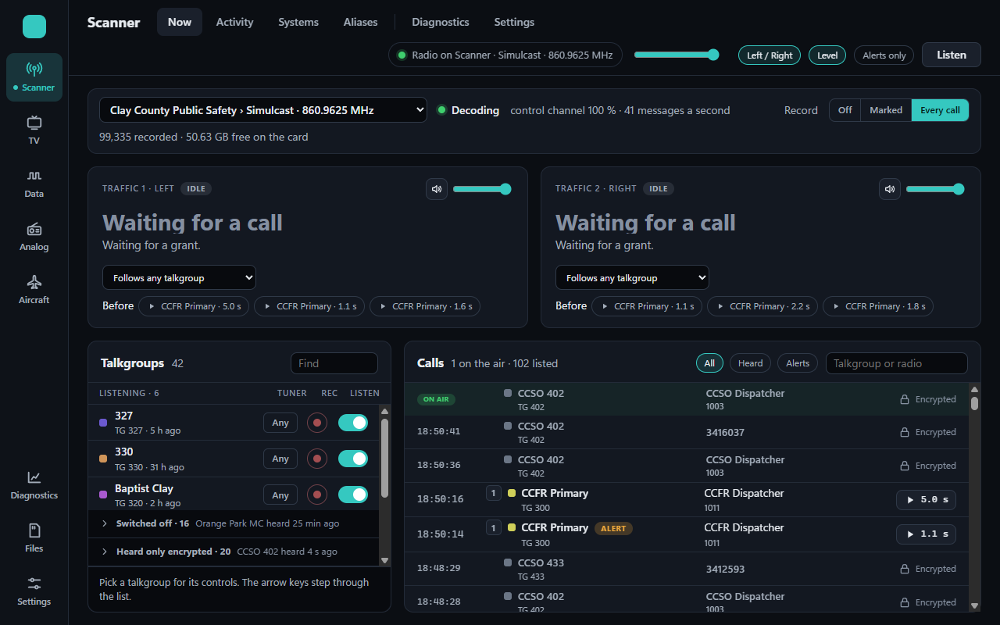

The page to leave open: what is on the air, and the controls you reach for.

- **The site bar,** at the top: the site the radio is on (pick another from the list to switch),
  whether its control channel decodes, and **Record**: Off, Marked (only the talkgroups marked
  Rec) or Every call.
- **The two tuners,** Traffic 1 and Traffic 2: the call each is on, a list to keep it on one
  talkgroup (it follows any otherwise), its last three calls to play again, and its own volume
  and mute in this browser.
- **Talkgroups:** those heard in the last week, in three groups: listened to, switched off, and
  heard only encrypted. A row has the tuner it may use (Any, 1 or 2), its Rec mark and its
  Listen switch. Click a talkgroup, or step with the arrow keys, for its controls under the
  list: hold a tuner on it, skip it, record it, set its tuner and priority, rename it. Keys: `H`
  hold, `L` listen, `R` record, `0`, `1`, `2` the tuner.
- **Calls:** the calls as they happen, newest first, with a play button on each one recorded.
  All, Heard or Alerts; the box finds a talkgroup or a radio.

To hear the radio in the browser, press **Listen** in the header. Beside it:

- **Left / Right:** Traffic 1 plays on the left speaker and Traffic 2 on the right; off, both
  play on both.
- **Level:** evens out loud and quiet talkers.
- **Alerts only:** plays only the talkgroups an alert tone opened (a console's warble or beep,
  a two-tone page), for the time you choose.

### Activity

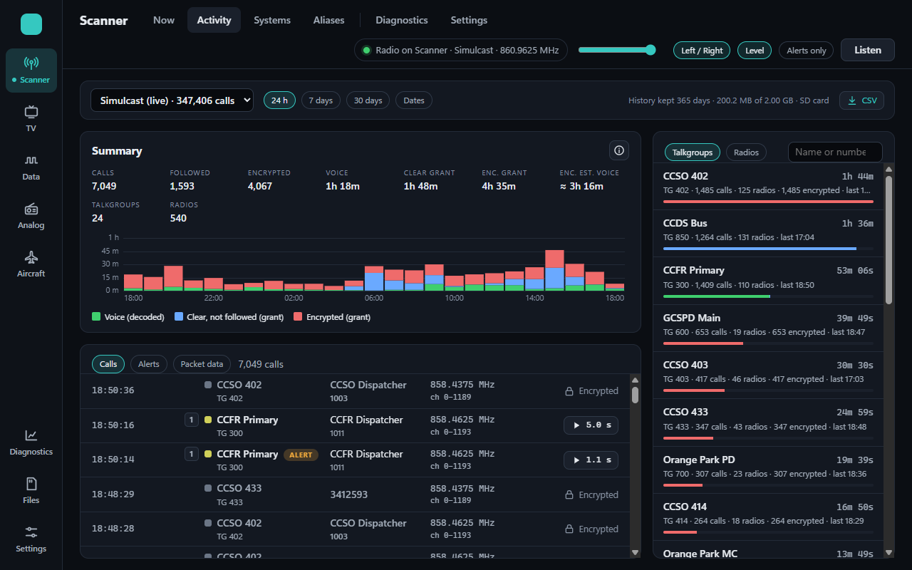

The history: every call the scanner has seen, kept on the SD card.

- Pick the site and the period (24 h, 7 days, 30 days, or dates). **CSV** downloads the
  period's calls as a table.
- **Summary:** calls, how many were followed, how many were encrypted, the time on the air, and
  a chart by hour.
- **Calls, Alerts, Packet data:** the lists. Pick a call for its details and, if it was
  recorded, its player.
- **Talkgroups, Radios,** on the right: who talked most. Pick one and the page narrows to it.

### Systems

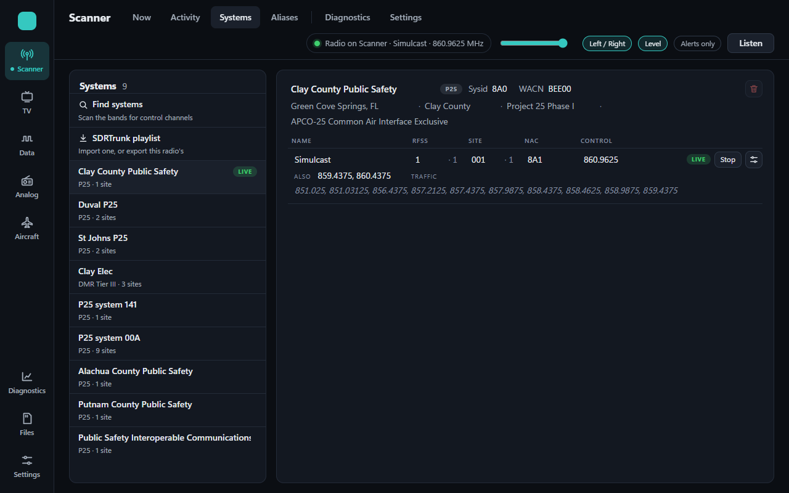

The trunked systems the scanner knows, and their sites.

- **Find systems** scans the bands for control channels and offers what it finds.
- **SDRTrunk playlist** imports a playlist (its systems, sites and aliases) or exports this
  radio's as one.
- A system's sites are listed with their control channels. **Live** marks the site the radio is
  on; **Make live** on another site switches the radio to it.

### Aliases

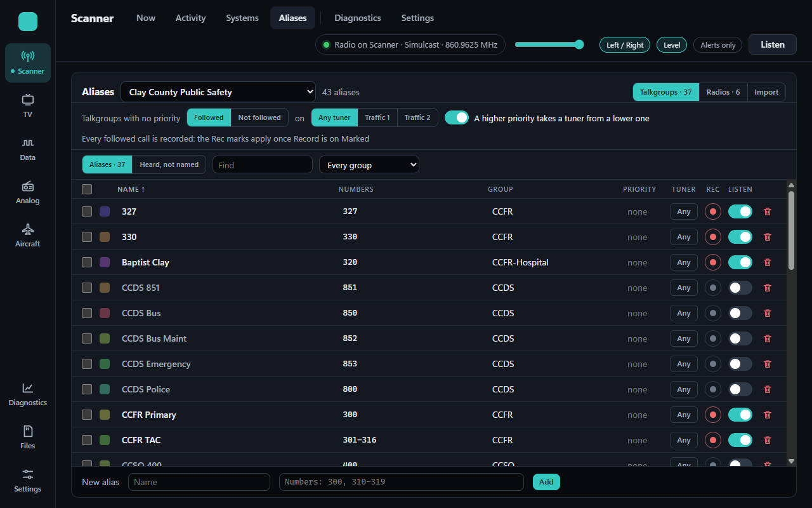

Names for talkgroups and radios, and how each talkgroup is treated.

- Pick the system. A row is an alias: its colour, name, numbers (one, several or a range), its
  group, its priority, the tuner it may use, whether it is recorded and whether it is listened
  to. A field is changed in its row and saved at once.
- **Heard, not named** lists what the scanner heard in the last week that has no alias: name it
  in place.
- **Import** takes RadioReference's files and shows what it would change before it does.
- The line above the table sets how talkgroups with no priority are treated, and whether a
  higher priority may take a tuner from a lower one.

### Scanner diagnostics

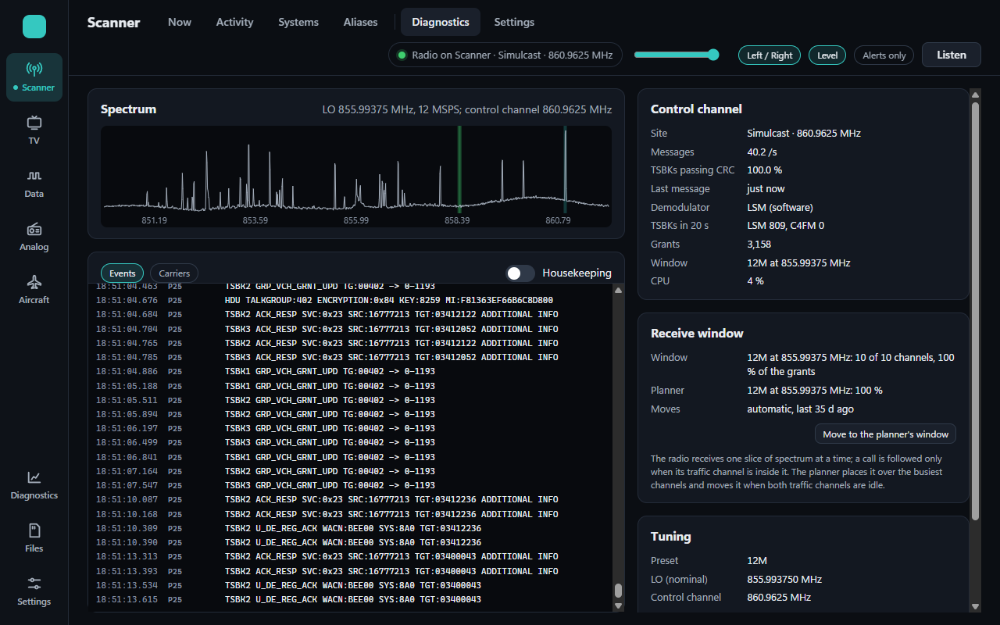

What the scanner receives: the spectrum of its window with the control channel marked, the
control channel's messages as they are decoded (Events) or the carriers heard, the decode rate,
and where the receive window is. The radio receives one slice of spectrum at a time and follows
a call only when its traffic channel is inside it; the planner places the window over the
busiest channels.

### Scanner settings

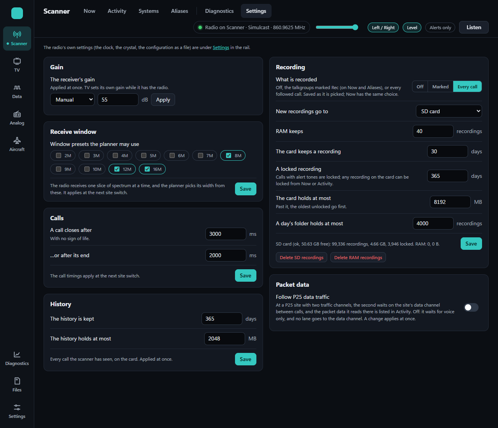

The scanner's own settings, a card each, each saved by itself: the receiver's gain, the window
sizes the planner may use, when a call is closed, how long the history is kept, what is
recorded and for how long, and whether P25 packet data is followed.

## TV

ATSC television: a channel finder, and a player in the browser for the channels it finds. It
needs a TV antenna on the receiver.

### Watch

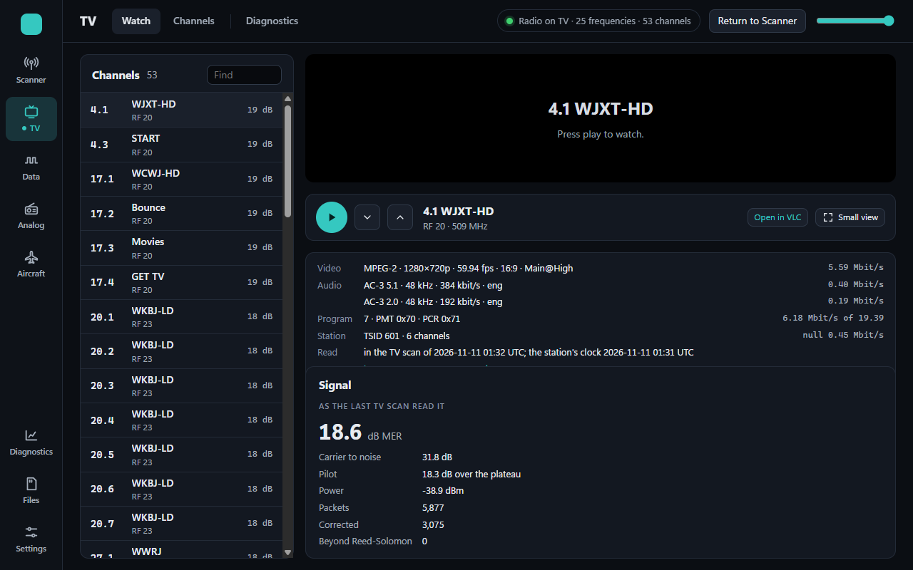

The channels the last scan named, on the left. Pick one and press play: the radio tunes its
frequency and the picture and sound are decoded in the browser. The button on the right steps
through the small view, the large view and full screen; **Open in VLC** hands the channel's
stream to a player on the PC. Under the player: the channel's video and audio formats and the
signal as the last scan read it.

### Channels

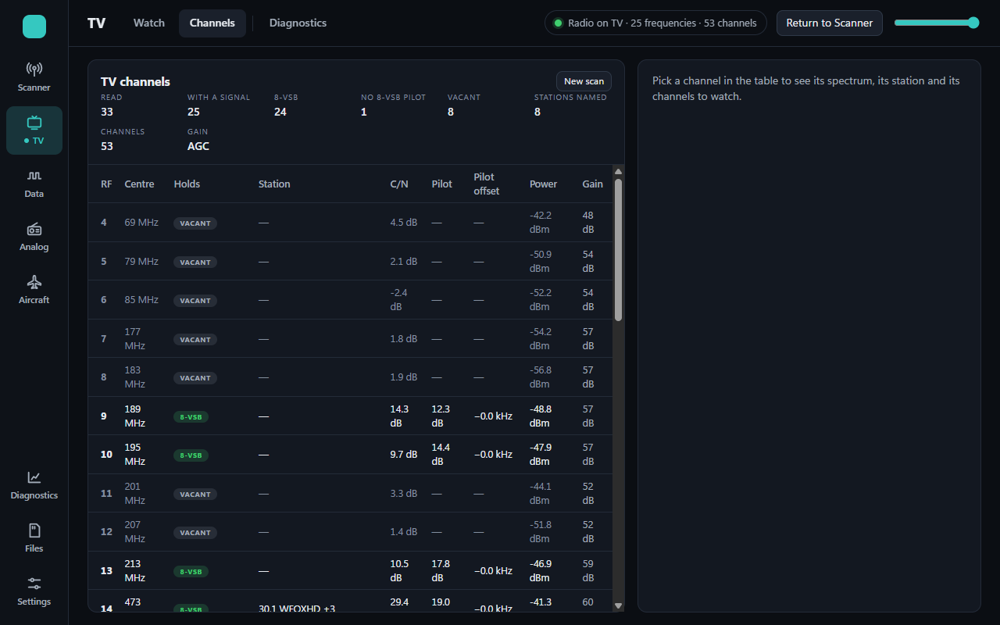

The channel finder. **New scan** steps through the TV band and says what each channel holds:
vacant, an 8-VSB signal, its carrier to noise and pilot, and the station's name and channels
once they are read. The last scan is kept. Pick a row for its spectrum and its channels.

## Data

A receiver for the small devices of the 433.92 MHz band (weather sensors and the like): it
finds their bursts, reads the ones it has a decoder for, and can keep a burst's samples for
study on a PC.

### Scan

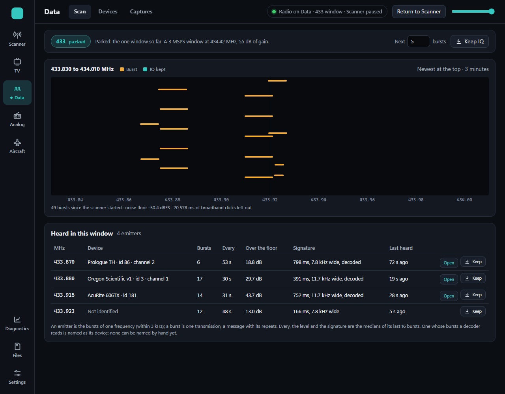

What is heard in the window. Each bar is a burst, at its frequency, the newest at the top. The
table under it gathers the bursts of one frequency into an emitter: how often it sends, how
strong it is, what its bursts look like, and its name once a decoder has read it. **Keep IQ**
saves the samples of the next bursts (of any emitter, or of one, with its own Keep button).

### Devices

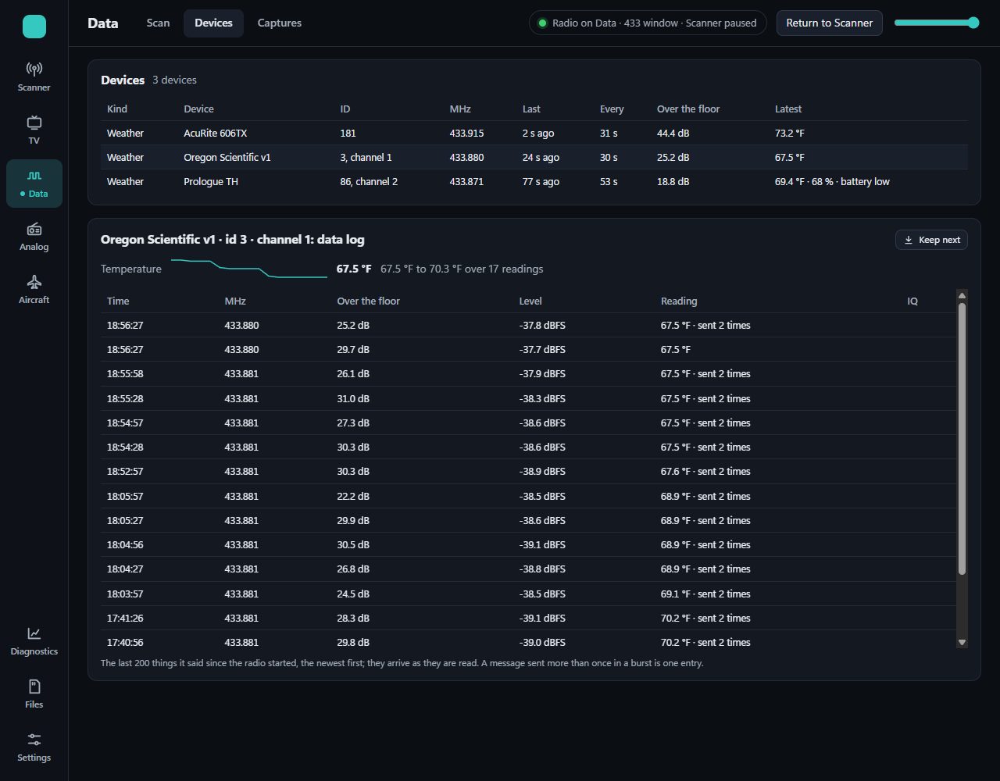

The devices read: the kind, the model, its id, when it last sent and what it said. Pick one for
its data log, with a line for each thing it measures. Temperatures are shown in the unit picked
in the radio's Settings.

### Captures

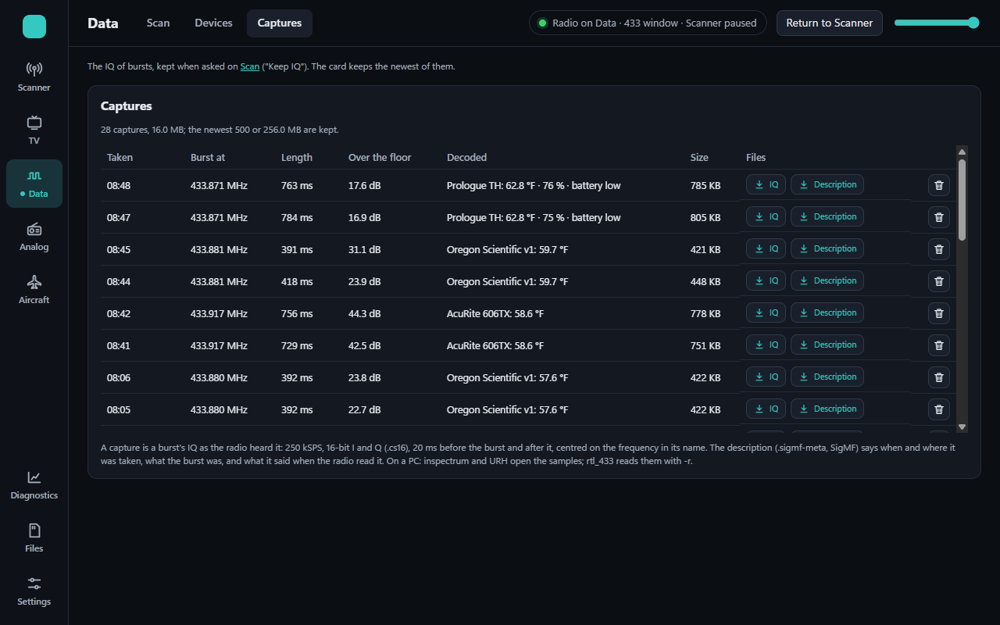

The bursts kept on the card: when, where, how long, what was decoded, and two downloads each,
the samples (`.cs16`) and their description (SigMF). inspectrum, URH and rtl_433 open them.

## Analog

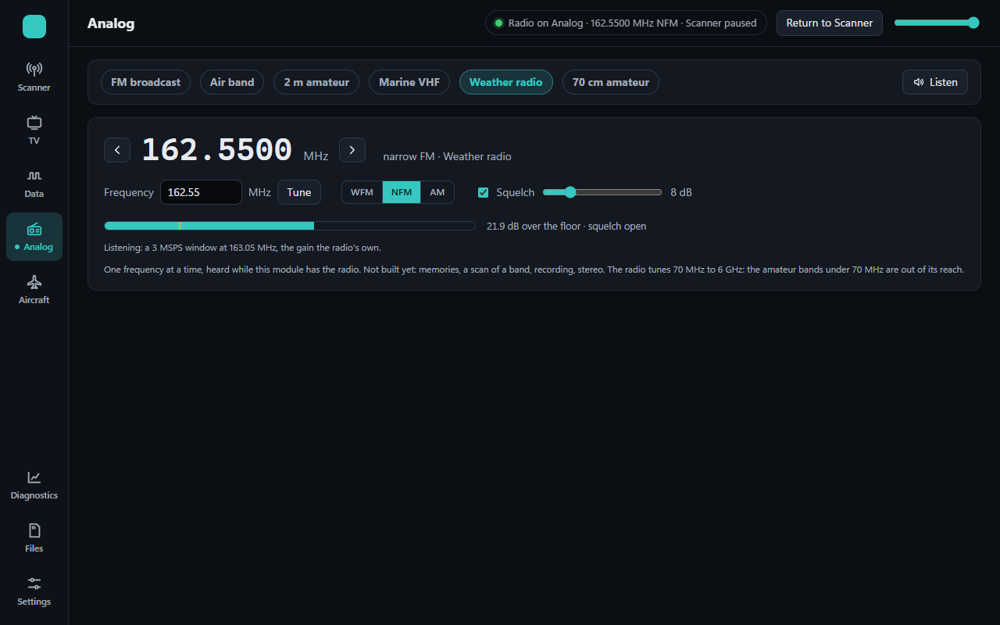

A plain receiver, parked on one frequency: wide FM (broadcast radio), narrow FM (weather radio,
two-way radio, amateur repeaters) or AM (the air band).

- Pick a band, type a frequency or step with the arrows.
- **WFM, NFM, AM** set how it is demodulated. The narrow kinds have a squelch: the meter shows
  the signal over the noise floor, with a mark at the squelch.
- **Listen** plays it in this browser.

The radio tunes from 70 MHz to 6 GHz, so the bands under 70 MHz are out of its reach.

## Aircraft

Aircraft send their position, altitude and speed themselves (ADS-B), on two links: 1090 MHz
(airliners and most others) and, in the United States, 978 MHz (UAT, small aircraft). The
module hears them with the scanner's own antenna.

### Aircraft

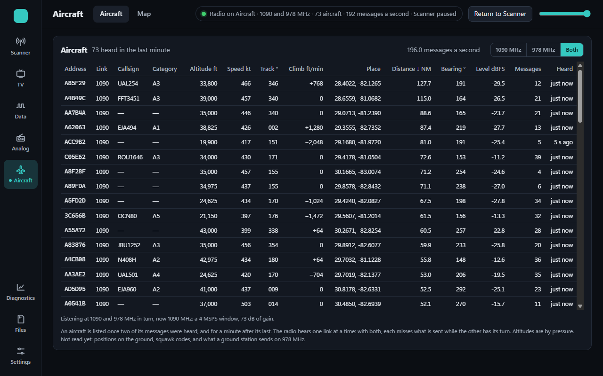

Every aircraft heard in the last minute, a row each: its address, callsign, category, altitude,
speed, track, rate of climb, place, and how strong and how recent its last message was. A
column's head sorts by it.

- **The link** (top right): 1090 MHz, 978 MHz, or **Both**, each in turn (ten seconds on 1090,
  five on 978). The radio hears one at a time.
- **Distance and Bearing** are from the radio, once the radio's Settings say where the radio is
  (Position, under [Radio settings](#radio-settings)). In the picture they are from a made-up
  place.

### Map

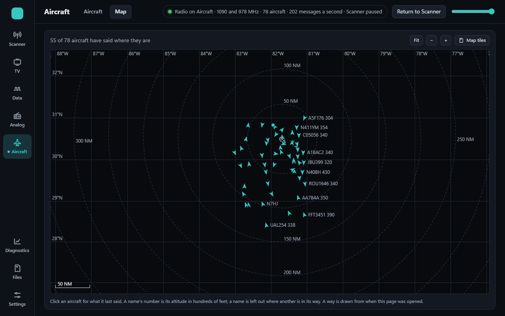

The same aircraft at their places, each pointing along its track, with its callsign and its
altitude in hundreds of feet where there is room, and the way it has come since you opened the
page.

- Drag to move, the wheel or **+** and **−** to zoom. **Fit** brings every aircraft into view
  and keeps them there until you move the map.
- Click an aircraft for what it last said, in the line under the map.
- With the radio's place set, the radio is marked and **range rings** are drawn round it, in
  nautical miles.
- **Map tiles** lays a street map under the aircraft. It is off until you switch it on, because
  the map then comes from the Internet: your browser fetches it from OpenStreetMap, which so
  learns what part of the map you look at. Without it the page draws a grid of latitude and
  longitude. The choice is remembered by the browser.

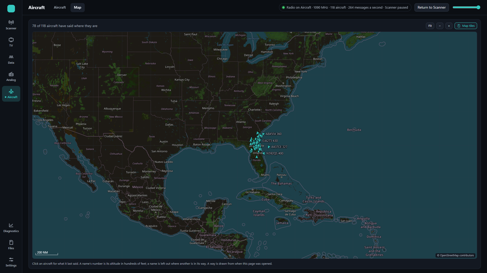

## The radio's own pages

### Radio diagnostics

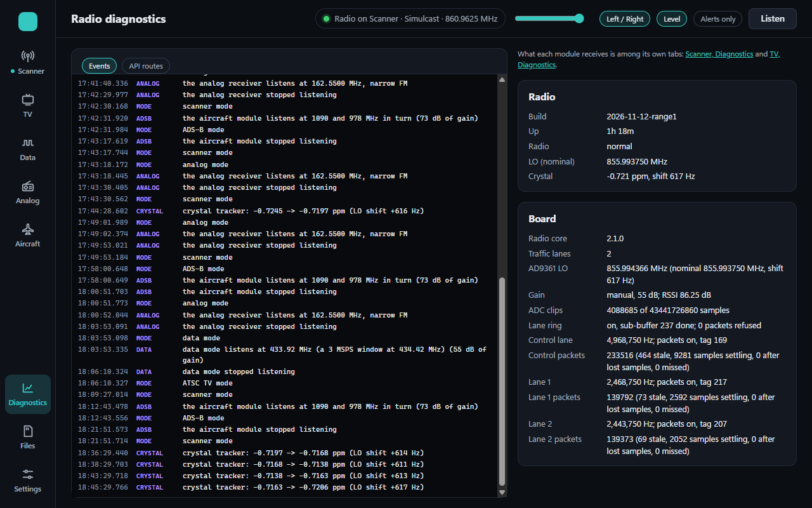

The radio's log (its start, each change of mode, the clock, the crystal), the list of the API's
routes, and the state of the radio and the board. What each module receives is in that module's
own Diagnostics tab.

### Files

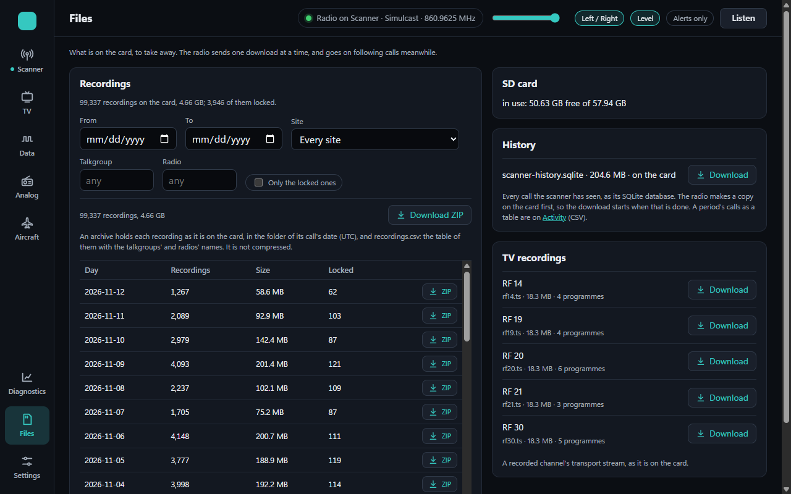

What is on the SD card, to take away:

- **Recordings,** as a ZIP archive: all of them, a day's, or a selection by date, site,
  talkgroup or radio. The archive carries a table of its recordings with the talkgroups' and
  radios' names.
- **History:** every call the scanner has seen, as its SQLite database.
- **TV recordings:** a recorded channel's transport stream.

The scanner goes on following calls while it sends a download.

### Radio settings

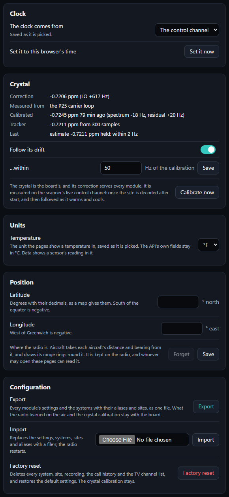

The settings that belong to the radio and not to one module. Beside those in the picture there
is the Access card, described below.

- **Clock:** where the board's clock comes from: the control channel (which works with no
  Internet), the Internet, or by hand.
- **Crystal:** the receiver's frequency correction, measured on the scanner's control channel
  and followed as the board warms and cools.
- **Units:** °C or °F.
- **Position:** where the radio is, as a latitude and a longitude in
  decimal degrees (south and west are negative). The Aircraft module takes each aircraft's
  distance and bearing from it and draws its range rings round it. Nothing finds it for you:
  the radio has no GPS. Whoever may open these pages can read it.
- **Configuration:** export every setting, system, site and alias as one file; import one;
  or reset the radio to new.

### Access

A new radio is open: anyone who can reach it on the network can listen to it and change it,
and the Access card says so until you set a password.

- **The administrator's password** (eight characters or more) closes it. From then on every
  browser and tool signs in, and the radio answers only over HTTPS.
- **A listener** has a second password: a listener sees and hears the radio and changes
  nothing.
- **Tokens for tools:** a token lets a script use the API as a listener or as the
  administrator, and can be revoked by itself.
- **HTTPS** is under a certificate authority the radio makes for itself. Download its
  certificate from the card and install it on your PC as a trusted root, and the browser trusts
  the radio; until then it warns.
- **The board as a tuner (libiio):** lets another program (SDR++, SDRTrunk, GNU Radio) use the
  board as a tuner over the network or the USB cable. It is off unless you switch it on,
  because such a program retunes the radio under the scanner.
- **A password that is lost:** put an empty file named `scanner-reset-access` on the card and
  restart the radio.
