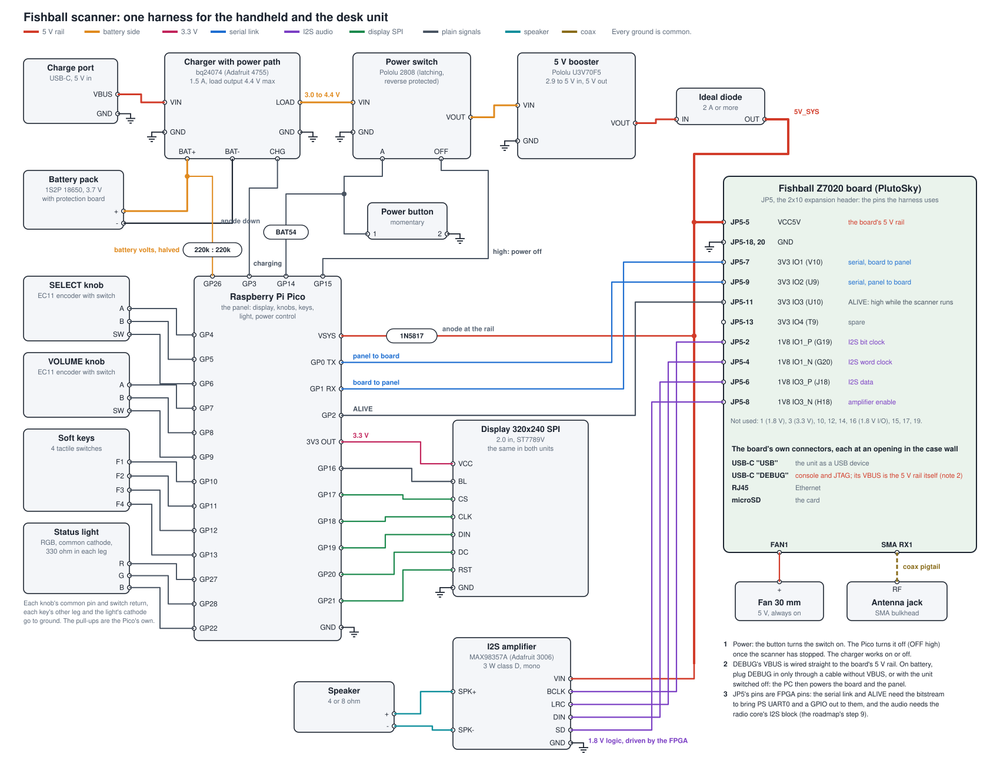
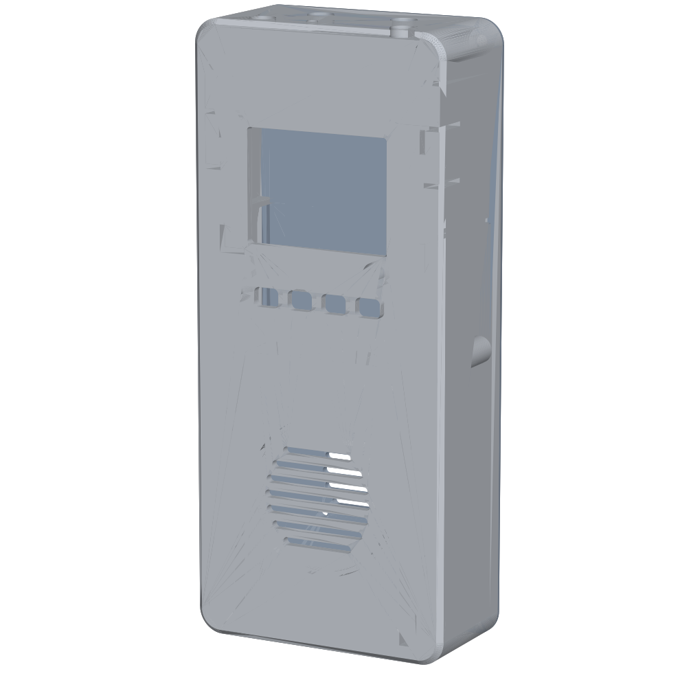
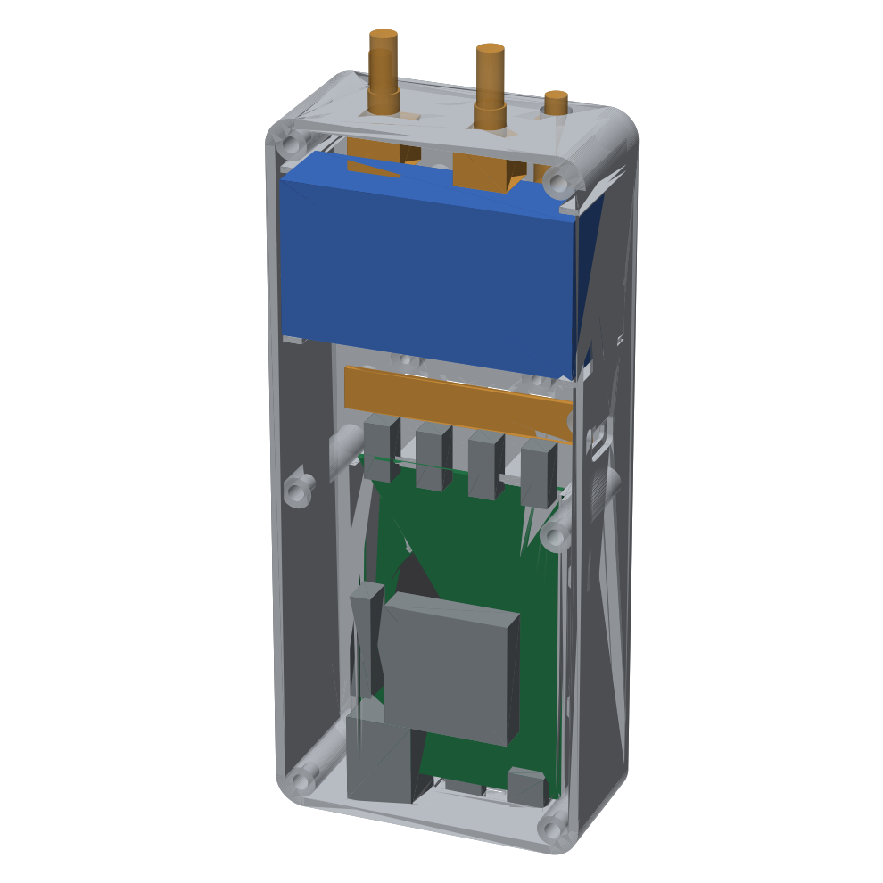
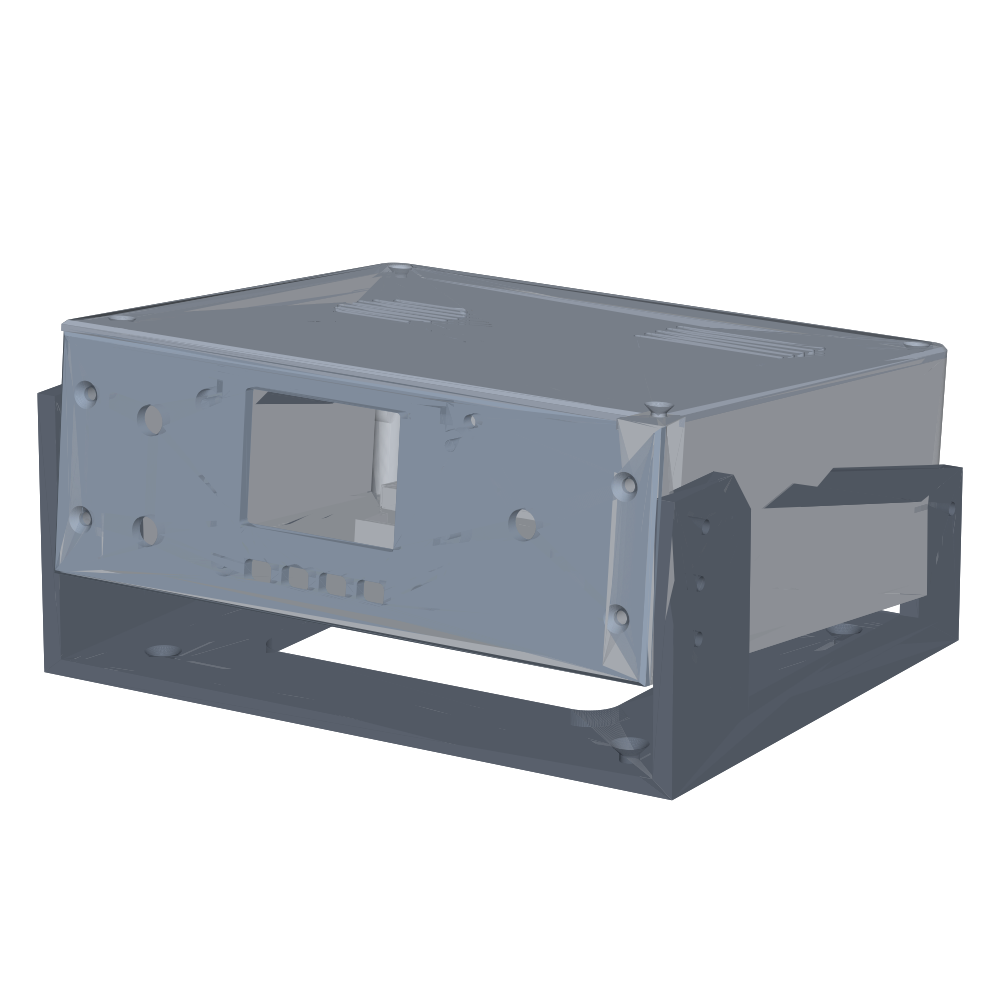
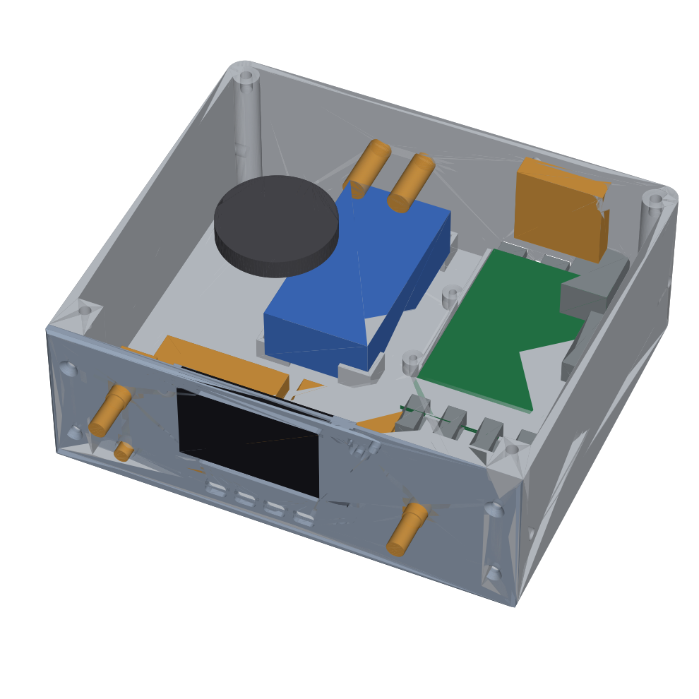

# The handheld and the desk unit: wiring and cases

One set of electronics around the Fishball board, in two printed cases: a handheld, and a unit
that stands on a desk. This is the roadmap's step 9 ("The handheld", Q13) taken as far as paper
and CAD go: a wiring diagram, a parts list, and two case models that build. **Nothing here has
been wired or printed.** Sizes that come from a maker's drawing are named as such; the rest are
marked "assumed" and are the first things to measure.

- The wiring: [wiring/wiring_diagram.svg](wiring/wiring_diagram.svg), drawn by
  `wiring/wiring_diagram.py`.
- The cases: `cases/` (FreeCAD scripts), their output in `cases/out/handheld/` and
  `cases/out/desk/` (STEP as assembled, STL as printed, previews, a report).



## What the board gives

From the board's schematic (`_shared/Hardware/OpenSDRLab-7020/`), the vendor's schematic and the
vendor's own printed case (`OpenSourceSDRLab/PlutoSky_7020_AD936X_SDR`, "hardware" and "3D case"),
whose reference designators match ours: the board is OpenSourceSDRLab's PlutoSky.

| What | Fact | Where it comes from |
|------|------|---------------------|
| Outline | About 50 x 79 mm. One short edge has the Ethernet jack, the DEBUG USB-C with the microSD slot under it, and the USB USB-C; the other has the four SMA jacks | The pocket and the openings of the vendor's case model |
| How it is held | By its two long edges on a ledge, and by four posts pressing on its upper face near the edges | The same model. A review says the aluminium case holds it on plastic pillars, so it has holes too; their places are not known here and the cases do not use them |
| 5 V in | The DEBUG USB-C's VBUS **is** the 5 V rail: no diode, no switch. The USB port's VBUS reaches the rail through a P-FET's body diode, and squarely only when the PHY's `OTG_EN` is high | Vendor schematic, sheet `USB_PMU` |
| Regulators | Five TPS82130 modules from the 5 V rail (1.0, 1.35, 1.8, 3.3 and 1.6 V), two LDOs for the AD9361 | Vendor schematic, sheets `ZYNQ_PMU` and `AD936X_PMU` |
| Draw at 5 V | **Not measured.** Taken here as 3 to 5 W | An estimate: measure it with a USB meter before choosing a battery |
| Spare pins | JP5, a 2x10 header: four 3.3 V pins (bank 13: V10, U9, U10, T9), eight 1.8 V pins (bank 35), and the 5 V, 3.3 V and 1.8 V rails | `07_EXPANSION_IO.md` |
| Their use today | None, but for `pl_spi_clk_o` on L14 (JP5-14), a leftover of upstream's design | `maia-hdl/projects/fishball7020_p25/system_constr.xdc` |
| Audio out | None. The PS has no I2S; the MIO pins for I2C and a second UART are not connected | `03_PS_MIO.md` |
| Fan | FAN1, on the 5 V rail, always on. A review calls the vendor's fan loud | `07_EXPANSION_IO.md` |

What the project had already settled: `doc/PANEL_ADDON_BOARD.md` chose a microcontroller for the
panel on a serial link and I2S for the amplifier from the PL, and the roadmap carries the I2S
block as "decided, not built". This design keeps both.

What changes from that document, and why:

- **The microcontroller is a Raspberry Pi Pico**, not the XIAO ESP32-S3. The panel now needs 26
  pins (two knobs, four keys, the display, the light, the link, the power control, the battery);
  the XIAO has 11. The Pico also has no radio to sit beside the receiver.
- **Battery power**, which that document left out: a charger with a power path, a latching
  switch the panel can turn off, and a 5 V booster.
- **The display is a 2.0 inch 320x240 SPI LCD**, the same module in both units, so both run one
  screen layout. That document's 1.5 inch OLED is 128x128.
- **The antenna jack is on a short coax pigtail**, not the board's own SMA: the board's
  connectors are on its two opposite ends, and only one end can be at a wall.

## The wiring

One harness serves both units. Four groups:

1. **The power chain.** Charge port (USB-C, 5 V) to the charger; the battery pack on the
   charger; the charger's load output (the USB's power when it is there, the battery's when not)
   through the power switch to the booster; the booster's 5 V through an ideal diode to
   `5V_SYS`, which is the board's own 5 V rail at JP5 pin 5.
2. **The panel.** A Pico fed from `5V_SYS`, with the display on its SPI, the two knobs, the four
   soft keys, the status light, and the three wires of the power control.
3. **The link.** Two serial wires and one "alive" wire between the Pico and JP5's 3.3 V pins.
4. **The audio.** An I2S amplifier fed from `5V_SYS`, its three I2S wires and its enable on
   JP5's 1.8 V pins, and the speaker.

The board's own Ethernet, USB, DEBUG and SD connectors are not wired anywhere: each looks out
through an opening in the case wall.

### JP5

| Pin | Net | FPGA ball | Use |
|-----|-----|-----------|-----|
| 5 | VCC5V | | `5V_SYS`: the booster feeds the board here |
| 18, 20 | GND | | Ground |
| 7 | 3V3 IO1 | V10 | Serial, board to panel (the Pico's GP1) |
| 9 | 3V3 IO2 | U9 | Serial, panel to board (the Pico's GP0) |
| 11 | 3V3 IO3 | U10 | ALIVE: the scanner holds it high while it runs (the Pico's GP2) |
| 13 | 3V3 IO4 | T9 | Spare |
| 2 | 1V8 IO1_P | G19 | I2S bit clock |
| 4 | 1V8 IO1_N | G20 | I2S word clock |
| 6 | 1V8 IO3_P | J18 | I2S data |
| 8 | 1V8 IO3_N | H18 | Amplifier enable (its SD pin) |

Not used: 1 (1.8 V), 3 (3.3 V), 10, 12, 14 and 16 (1.8 V I/O), 15, 17, 19. The I2S pins are the
ones `PANEL_ADDON_BOARD.md` chose. Which way the header's pin 1 lies on the board is not known
here: find pin 5 and a ground with a meter before the first plug goes on.

### The Pico

| Pin | To | Notes |
|-----|-----|------|
| GP0 (UART0 TX) | JP5-9 | 3.3 V on both sides |
| GP1 (UART0 RX) | JP5-7 | |
| GP2 | JP5-11 | ALIVE, an input |
| GP3 | The charger's charge-status pad | Open drain, the Pico's pull-up |
| GP4, GP5, GP6 | SELECT knob: A, B, switch | An EC11; its common and switch return to ground |
| GP7, GP8, GP9 | VOLUME knob: A, B, switch | |
| GP10 to GP13 | Soft keys F1 to F4 | Each to ground when pressed |
| GP14 | The power button, through a BAT54 | Anode at the Pico, cathode at the button: the button's other side is at battery voltage |
| GP15 | The power switch's OFF pin | High turns the power off |
| GP16 | Display backlight | PWM |
| GP17, GP18, GP19 | Display CS, CLK, DIN | SPI0 |
| GP20, GP21 | Display DC, RST | |
| GP22, GP27, GP28 | Status light: blue, red, green | 330 ohm in each leg |
| GP26 (ADC0) | Battery voltage, halved | Two 220 kohm resistors from the charger's BAT pad |
| VSYS | `5V_SYS`, through a 1N5817 | So that the Pico's own USB can be plugged in beside it |
| 3V3 OUT | The display's VCC | |

Free: nothing. A third key or a second light means an I/O expander, or giving up the display's
reset pin (tied high, it is reset by command).

### Power, and how the unit turns on and off

- **On:** the button connects the switch's pin A to ground, the switch latches on, the booster
  starts, the board and the Pico come up together.
- **Off:** the Pico sees the same press through the diode. On a long press it asks the scanner
  to stop (the card's files and the history's database are closed, the card unmounted), waits
  for ALIVE to fall, with a time limit, and raises OFF. A plain switch in the battery lead
  would cut the board off in the middle of a write.
- **Charging** needs neither: the charger is on the battery side of the switch.
- **The ideal diode** keeps the board's rail from feeding the booster backwards when the board
  is powered from its DEBUG port with the unit switched off.

**The DEBUG port and the battery.** DEBUG's VBUS is wired straight to the 5 V rail. With the
unit running on its battery, a PC plugged into DEBUG is tied to the booster's output with
nothing between. Use DEBUG through a cable or adapter without VBUS, or switch the unit off
first: the PC then powers the board, and the panel with it. The USB port has no such trap while
it is a device: its FET is off and the diode in it blocks the rail.

**The amplifier on 1.8 V logic.** The MAX98357A's I2S inputs are driven at 1.8 V here, as
`PANEL_ADDON_BOARD.md` planned, on its reading of the datasheet (1.3 V is a high). Adafruit's
page speaks of 3.3 and 5 V logic only; I could not open the datasheet to confirm the 1.3 V.
Confirm it before wiring, or put a level shifter in the four wires.

### What it needs from the gateware and the daemon

None of this exists yet. A wired harness does nothing until:

- **The bitstream** brings the PS's UART0 out to V10 and U9 and one GPIO in on U10 (wiring in
  the block design and three lines of constraints at 3.3 V), and has the radio core's I2S block
  on G19, G20, J18 and H18 (the bake the roadmap's step 9 names, with 079's gates).
- **The daemon** has its own listening path (the audio it now sends to browsers, mixed for one
  speaker with a volume), and the panel's service on the serial port: the state out, the knobs
  and keys in, each of them an operation the API already has.
- **The Pico's firmware:** the screens, the knobs, the power sequence, the battery's level.

## The parts

"Checked" means read on the maker's page while this was written.

| Part | What | Sizes and ratings |
|------|------|-------------------|
| Panel controller | Raspberry Pi Pico (RP2040), no headers | 51 x 21 mm |
| Display | 2.0 inch IPS, 320x240, ST7789V, SPI (Waveshare "2inch LCD Module") | Checked: outline 58 x 35 mm, active 40.8 x 30.6 mm. Thickness 4.5 mm assumed |
| Knobs | 2 x EC11 encoder with switch, 6 mm D shaft | Hole 7.2 mm |
| Soft keys | 4 x 6 mm tactile switch, 4.3 mm high, on a strip of perfboard | Under printed caps |
| Power button | Momentary push button, 7 mm thread | Hole 7.2 mm |
| Status light | 3 mm RGB LED, common cathode, 3 x 330 ohm | Hole 3.1 mm |
| Amplifier | MAX98357A breakout (Adafruit 3006) | Checked: 19.4 x 17.8 x 3.0 mm, 2.7 to 5.5 V, 3.2 W into 4 ohm |
| Speaker | 40 mm, 4 or 8 ohm, 2 W, no deeper than 7 mm | Assumed |
| Battery | 1S2P 18650 pack with its protection board and leads | About 69 x 37 x 19.5 mm, assumed |
| Charger | Adafruit 4755 (bq24074, power path) | Checked: 1 A charge as shipped, 1.5 A by a jumper; 5 to 10 V in; load output 4.4 V at most |
| Power switch | Pololu 2808, Mini Pushbutton Power Switch, LV | Checked: 2.2 to 20 V, about 6 A; ON, OFF, CTRL, A, B |
| Booster | Pololu 2891, U3V70F5 | Checked: 2.9 to 5 V in, 5 V out, ENABLE; 40.6 x 15.2 x 4.6 mm |
| Ideal diode | Any module good for 2 A | |
| Charge port | A USB-C breakout for power: VBUS, ground, 5.1 kohm on each CC | 13 x 22 mm assumed |
| Antenna | SMA plug to SMA bulkhead jack on RG316, 10 to 15 cm | One in the handheld, two in the desk unit |
| Fan | 30 mm, 5 V, 7 to 10 mm thick | The aluminium case's own would do |
| Small parts | BAT54, 1N5817, 2 x 220 kohm | |
| Screws | M3 self-tapping, 8 mm, for the clamp tabs and the key strip; M3 heat-set inserts and M3 screws for the covers, the desk unit's panel and its bracket | Handheld: 6 inserts. Desk: 12 (panel 4, cover 4, sides 4), and four M3 thumbscrews for the bracket |

### How long on a battery

An estimate from the 3 to 5 W above, not a measurement: the board 4 W, the fan 0.5 W, the panel
0.3 W, the audio 0.3 W on average, the booster at 90 %: about 5.7 W from the pack. Two 3.4 Ah
cells hold about 24 Wh: **about four hours**. The charger passes at most 1.5 A at 5 V, which is
little more than the unit draws, so it charges slowly while it runs and at its full rate (five
to seven hours for the pack) when it is off.

## The cases

Both are built by `cases/build.py`. Both hold the board the way the vendor's case does: its long
edges on two rails, four printed tabs screwed to posts beside it pressing on the four spots the
vendor's posts press on. The connector openings are the vendor's, to the hundredth.

The same tab, on the same M3 screw, holds the display (and, in the desk unit, the speaker and
the charge port's board). Both units take the same bought parts: one display, one speaker, one
battery pack, the same knobs and keys.

### The handheld

75 x 170 x 37 mm: a tub that holds everything, printed on its front face, and a back cover.




- **Front:** the display, four soft keys under their labels, the speaker's slots.
- **Top:** the antenna jack, the two knobs, the status light, the power button.
- **Bottom:** the board's own Ethernet, DEBUG, SD and USB openings, as on the vendor's case.
- **Left side:** the charge port.
- **Back:** the fan's opening over the Zynq and a vent above it.
- **Inside, from the bottom:** the board standing on its connector edge, its parts toward the
  back and the speaker in front of it; a bay over its SMA jacks for the charger, the switch, the
  booster and the amplifier; the battery pack lying across behind the display, with the Pico
  between them; the knobs' bodies under the top.

### The desk unit

A radio in the shape of a mobile transceiver, as Andy asked ("like a ham radio", with a picture
of a mobile rig, and "we can use same parts as handheld"): 160 x 140 x 60 mm, hung by two screws
a side in a bracket 171 mm wide that stands on the desk or is screwed to it. Four shells: a
tray, a front panel, a top cover and the bracket. All fit a 180 mm bed.




- **Front panel:** the display in the middle with the four soft keys in a row under it; the
  volume knob and the power button on the left; the large dial and the status light on the
  right.
- **Top:** the speaker's slots, and vents over the Zynq.
- **Rear wall:** the board's Ethernet, DEBUG, SD and USB openings, the fan over them blowing
  along the board, two antenna jacks, the charge port.
- **Bracket:** the radio turns about its rear side screws; the front ones go into one of three
  holes, for level, 6 or 12 degrees tipped back. The base has four holes for screwing it down,
  so it can also hang under a shelf. Without the bracket the radio stands on four stick-on feet.
- **Inside:** the board flat at the right rear, the battery pack beside it, the power modules on
  the floor behind the panel. The battery is optional here: the charger runs the unit from the
  charge port alone.

### Building them

```sh
cd hardware/cases
"C:/Program Files/FreeCAD 1.0/bin/freecadcmd.exe" build.py
python render.py
```

`build.py` ends with `BUILD OK` when every part is one valid solid and nothing collides. What it
checks: each printed part against block models of the board with its connectors (and 20 mm kept
free over the board for the header's plug and the fan), the display, the speaker, the battery,
the knobs, the jacks and the power modules, and those block models against each other. As
built for this document: no collisions in either unit. Every size is a field of `Handheld` or `Desk`
(`cases/fishcase/handheld.py`, `desk.py`) or a constant of `board.py`.

Print: PETG, 0.2 mm layers, three perimeters. The handheld's tub on its front face and its cover
on its back; the desk unit's tray and bracket as they stand, its panel on its face and its cover
on its top. The STL files lie that way already. No part needs supports as modelled.

### What is not in the models

- **Mounts for the power modules, the amplifier and the Pico.** They have room (the block models
  say so) and no posts: foam tape for a first build.
- **A mount for the handheld's charge port.** The opening in the left wall is there; what holds
  the breakout behind it waits for the breakout.
- **The handheld speaker's hold-down.** It sits in a ring; there is no room behind it for a tab
  and a screw. Glue, or a foam pad against the board's rails.
- **Anything for the board's reset button, DIP switch and LEDs:** their places are not known.
- **A battery door.** The pack is reached by taking the cover off (six screws).

## Measure first

Before printing more than a test piece, with calipers on a real board and the real parts:

1. The board: 50 x 79 mm? Does it sit in the vendor's printed case, or only in the aluminium
   one?
2. JP5: where it is, how tall its socket is, and what a plug with wires adds. The models keep
   20 mm over the board; the handheld is as deep as that number makes it.
3. Whether the board has a heatsink or a fan on it, and its height.
4. Which SMA is RX1, and how far the jacks stand past the board's edge (10 mm assumed).
5. The board's draw at 5 V, scanning.
6. The display module: where the active area lies on its board (centred is assumed), and its
   thickness.

## What Andy has said

2026-11-12, shown the first version of this: "the design is good and matches intent. I can
measure with caliper later to update as needed", and "the handheld is a nice layout and a great
starting point". That settles, until a measurement says otherwise: the Pico as the panel's
controller, two knobs with four soft keys, a power button and one RGB light (the roadmap's Q13),
the LCD, two 18650 cells, the handheld at 75 x 170 x 37 mm, and the audio as I2S from the PL.

The desk unit was first drawn as a sloped console. He meant "more like a portable radio desk
mounted type design. like a ham radio", sent a picture of a mobile rig, and added "we can use
same parts as handheld": it is now the radio in a bracket described above.

Still open: a battery in the desk unit or not (the model has room for the pack and runs
without it), and everything under "Measure first".

## Sources

- Board: `_shared/Hardware/OpenSDRLab-7020/`; vendor schematic and case model,
  https://github.com/OpenSourceSDRLab/PlutoSky_7020_AD936X_SDR; a review,
  https://yramgu.github.io/Z93-Lab/plutosky.html
- Parts: https://www.pololu.com/product/2891, https://www.pololu.com/product/2808,
  https://www.adafruit.com/product/4755, https://www.adafruit.com/product/3006,
  https://www.waveshare.com/wiki/2inch_LCD_Module
- The first design: `doc/PANEL_ADDON_BOARD.md`; the plan: `doc/ROADMAP.md`, "The handheld".
